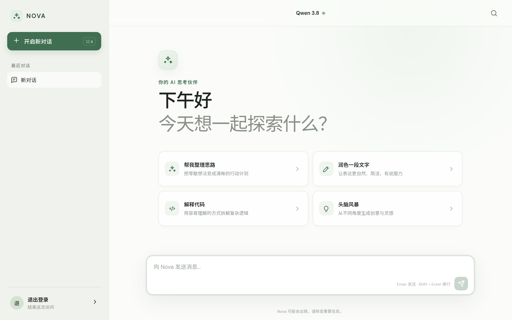

# Nova

一个极简的自托管 LLM 聊天前端：Cloudflare Worker 负责鉴权与转发，浏览器负责界面与历史记录。整套服务没有数据库、没有构建步骤、没有前端框架。



## 功能

- **口令登录**：单一访问口令，登录后签发 30 天有效的签名 Cookie
- **流式回复**：上游 SSE 原样透传到浏览器，边生成边显示，可随时停止
- **多对话管理**：本地保存多段对话，支持新建、删除、按关键字搜索
- **纯客户端历史**：对话只存在浏览器 `localStorage`，服务端不落库
- **移动端适配**：处理虚拟键盘、安全区域和视口高度变化
- **同源保护**：`/api/*` 校验 `Origin`，跨站请求直接拒绝

## 技术栈

| 层 | 选型 |
| --- | --- |
| 运行时 | Cloudflare Workers |
| 后端 | TypeScript（单文件，无框架） |
| 前端 | 原生 HTML / CSS / JavaScript，无构建工具 |
| 模型服务 | [Groq](https://groq.com/) OpenAI 兼容接口 |
| 开发工具 | Wrangler、TypeScript |

## 项目结构

```
.
├── src/
│   └── index.ts                  # Worker 入口：路由、鉴权、聊天代理
├── public/                       # 静态资源，由 ASSETS 绑定直接提供
│   ├── index.html                # 页面骨架（登录门 + 聊天界面）
│   ├── app.js                    # 前端逻辑：登录、会话、流式渲染
│   ├── styles.css                # 样式
│   └── favicon.svg
├── docs/
│   └── preview.png               # README 截图
├── wrangler.jsonc                # 部署配置：路由、绑定、模型、观测
├── tsconfig.json
├── worker-configuration.d.ts     # `npm run types` 生成，勿手改
└── package.json
```

## 本地开发

环境要求：Node.js 20+。

```bash
npm install
cp .dev.vars.example .dev.vars
```

编辑 `.dev.vars`，填入两个值：

```ini
GROQ_API_KEY=你的 Groq 密钥
APP_PASSWORD=你想要的访问口令
```

启动开发服务器：

```bash
npm run dev
```

打开 <http://localhost:8787>，输入 `.dev.vars` 里的 `APP_PASSWORD` 即可进入。没有真实 `GROQ_API_KEY` 时界面和登录都能用，只有发送消息会返回上游鉴权错误。

其他脚本：

```bash
npm run check   # tsc --noEmit 类型检查
npm run types   # 重新生成 worker-configuration.d.ts
```

## 部署

```bash
npx wrangler login
npx wrangler secret put GROQ_API_KEY
npx wrangler secret put APP_PASSWORD
npm run deploy
```

- 自定义域名在 `wrangler.jsonc` 的 `routes` 中配置，需先把该域名接入 Cloudflare。
- 模型通过 `wrangler.jsonc` 的 `vars.MODEL` 指定，改完重新部署即可。
- `vars` 是明文变量，密钥请一律用 `wrangler secret put` 或 `.dev.vars`。

## API

所有接口都在 `/api/` 下，其余路径由静态资源处理。

| 方法 | 路径 | 说明 |
| --- | --- | --- |
| `GET` | `/api/session` | 检查登录状态，返回 `{ "ok": true }` 或 401 |
| `POST` | `/api/login` | 请求体 `{ "password": "..." }`，成功后 `Set-Cookie` |
| `POST` | `/api/logout` | 清除登录 Cookie，返回 204 |
| `POST` | `/api/chat` | 请求体 `{ "messages": [{ "role": "user", "content": "..." }] }`，返回 SSE 流 |

`/api/chat` 的请求限制：

| 限制 | 值 |
| --- | --- |
| 请求体大小 | 200 KB |
| 消息条数 | 30 条（超出保留最近 30 条） |
| 单条消息长度 | 12,000 字符 |
| 历史总长度 | 48,000 字符 |
| 回复长度 | 4,096 tokens |

## 说明

- 对话历史保存在浏览器本地，换设备或清除站点数据后不可恢复。
- 消息以纯文本渲染，暂不支持 Markdown。
- 上游请求失败时会重试一次；4xx（403 除外）不重试，避免无意义调用。
- Groq 的常见错误会被翻译成中文提示，原始状态码同时记录在 Worker 日志中。
